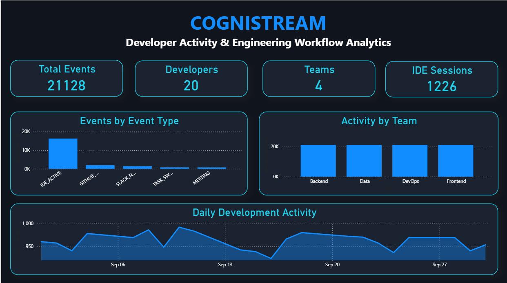
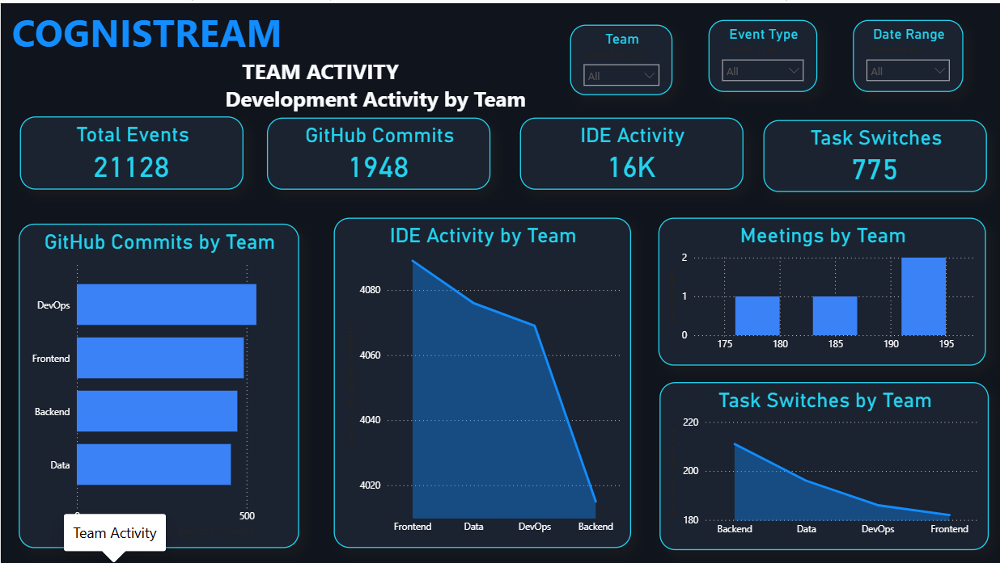
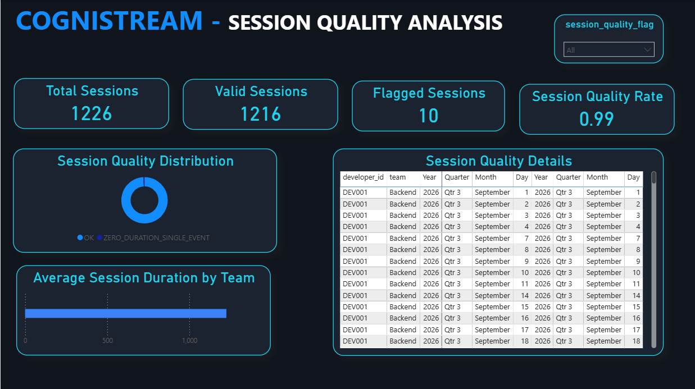
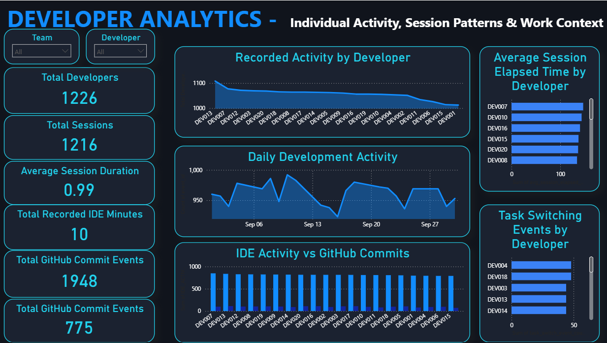
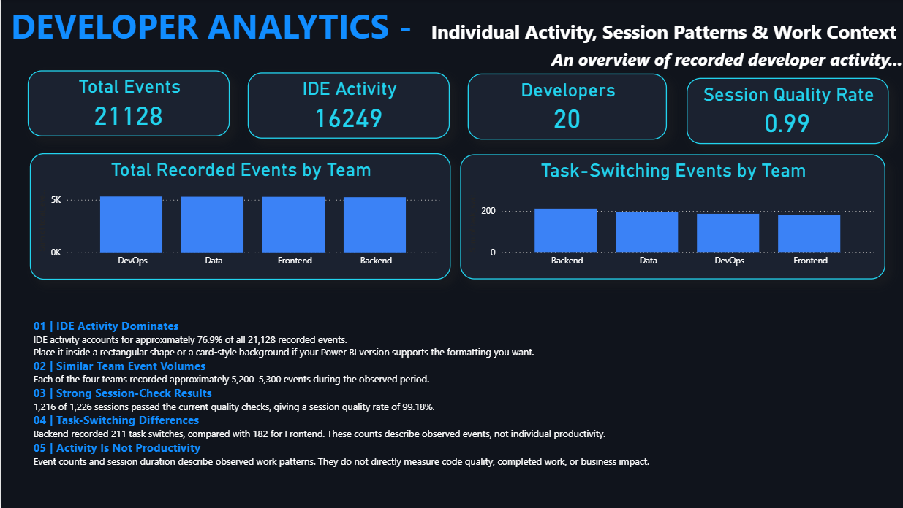

# CogniStream
### Developer Activity and Productivity Analytics

<p align="center">
  <strong>An End-to-End Data Analytics Project Using Python, Pandas, DuckDB, SQL and Power BI</strong>
</p>

<p align="center">
  
  
  
  
  
</p>

---

## Project Overview

**CogniStream** is an end-to-end data analytics project designed to analyze developer activity data, understand team-wise activity patterns, examine IDE session quality, and generate meaningful analytical insights through interactive Power BI dashboards.

Software development teams generate different types of activity data, including IDE usage, GitHub commits, meetings, Slack notifications, and task switching.

CogniStream processes and organizes this activity data using Python and DuckDB, performs analytical operations using SQL, and presents the results through Power BI visualizations.

The project demonstrates a complete data analytics workflow, from data processing to interactive reporting.

---

## Objectives

The main objectives of CogniStream are:

- Analyze developer activity patterns.
- Understand team-wise activity distribution.
- Examine IDE usage and session behaviour.
- Analyze GitHub commits, meetings, and task switching.
- Identify potential data-quality issues.
- Compare developer-level activity metrics.
- Generate interactive dashboards for analytical reporting.

---

## Dataset Overview

The project uses a **synthetic developer activity dataset** covering September 1–30, 2026.

| Metric | Value |
|---|---:|
| Total Events | 21,128 |
| Total Developers | 20 |
| Total Teams | 4 |
| Total IDE Sessions | 1,226 |
| IDE Activity Events | 16,249 |
| Dataset Period | September 2026 |
| Session Quality Rate | 99.18% |

### Development Teams

The dataset contains four development teams:

1. Frontend
2. Backend
3. Data
4. DevOps

Each team contains five developers.

### Event Types

The project analyzes the following activity types:

| Event Type | Description |
|---|---|
| IDE_ACTIVE | Developer activity inside an IDE |
| GITHUB_COMMIT | GitHub commit activity |
| SLACK_NOTIFICATION | Slack notification activity |
| TASK_SWITCH | Switching between tasks |
| MEETING | Meeting-related activity |

### Event Distribution

| Event Type | Event Count | Percentage |
|---|---:|---:|
| IDE_ACTIVE | 16,249 | 76.91% |
| GITHUB_COMMIT | 1,948 | 9.22% |
| SLACK_NOTIFICATION | 1,407 | 6.66% |
| TASK_SWITCH | 775 | 3.67% |
| MEETING | 749 | 3.55% |
| **Total** | **21,128** | **100%** |

---

## Technology Stack

| Technology | Purpose |
|---|---|
| Python | Data processing and automation |
| Pandas | Data manipulation and analysis |
| NumPy | Numerical operations |
| DuckDB | Analytical database management |
| SQL | Data querying and analytical operations |
| Power BI | Interactive dashboard development |
| CSV | Data storage and exchange |

---

## Project Architecture

CogniStream follows a structured data analytics pipeline.

```text
              Source Dataset
                    |
                    v
          Python Data Processing
                    |
                    v
             Pandas / NumPy
                    |
                    v
              DuckDB Database
                    |
                    v
               SQL Analysis
                    |
                    v
                CSV Export
                    |
                    v
             Power BI Dashboard
                    |
                    v
             Analytical Insights
```

### Workflow Explanation

**1. Data Processing**

Python and Pandas are used to load, organize, and process the developer activity datasets.

**2. Database Management**

Processed datasets are imported into DuckDB for structured storage and analytical querying.

**3. SQL Analysis**

SQL queries are executed to analyze event distribution, team activity, developer metrics, and IDE session quality.

**4. Data Export**

Analytical results are exported into CSV files using Python scripts.

**5. Visualization**

The exported datasets are used in Power BI to create interactive reports and visualizations.

---

## Database Structure

The project uses DuckDB as its analytical database.

The main database tables are:

| Table | Description |
|---|---|
| `events` | Stores developer activity events |
| `developer_metrics` | Stores developer-level analytical metrics |
| `ide_sessions` | Stores grouped IDE session information |
| `ide_events_with_sessions` | Stores IDE events associated with sessions |
| `team_metrics` | Stores team-level analytical metrics |

Database file:

```text
cognistream.duckdb
```

Additional analytical views include:

- `vw_event_overview`
- `vw_session_quality`
- `vw_team_activity`

---

## SQL Analysis

SQL is used to perform analytical operations on the processed datasets.

The main analysis areas include:

- Total event analysis.
- Unique developer identification.
- Event type distribution.
- Team-wise activity comparison.
- Developer-level activity analysis.
- IDE session analysis.
- Session quality checks.
- Missing-value checks.
- Duration validation.

These queries help transform structured activity records into meaningful analytical results.

---

# Power BI Dashboard

The Power BI report contains five analytical pages, each designed to provide a different perspective on developer activity.

## 1. Overview

Provides a high-level summary of the dataset through important KPIs and visualizations.

**Key metrics:**
- Total Events
- Total Developers
- Total Teams
- Total IDE Sessions



## 2. Team Activity

Compares activity patterns across Frontend, Backend, Data, and DevOps teams.

The analysis includes IDE activity, GitHub commits, meetings, Slack notifications, and task switching.



## 3. Session Quality

Examines IDE sessions and identifies potential data-quality issues.

| Session Metric | Result |
|---|---:|
| Total Sessions | 1,226 |
| Valid Sessions (OK) | 1,216 |
| Zero-Duration Single-Event Sessions | 10 |
| Session Quality Rate | 99.18% |



## 4. Developer Analytics

Provides developer-level analytical information, including activity counts, IDE usage, GitHub commits, meetings, task switching, and session-related metrics.



## 5. Executive Insights

Summarizes the important findings of the analysis through visual insights designed for quick interpretation.



---

## Key Analytical Findings

Based on the processed dataset:

1. The project contains 21,128 developer activity events.
2. IDE activity represents approximately 76.91% of all recorded events.
3. The dataset contains 20 developers distributed across four teams.
4. A total of 1,226 IDE sessions were analyzed.
5. Out of 1,226 sessions, 1,216 passed the defined session-quality checks.
6. The calculated session quality rate is approximately 99.18%.
7. Ten sessions were classified as `ZERO_DURATION_SINGLE_EVENT`.

These findings demonstrate how developer activity records can be organized and analyzed to understand recorded activity patterns.

---

## Project Structure

```text
CogniStream/
│
├── data/
│   ├── raw/
│   ├── processed/
│   └── powerbi/
│       ├── event_overview.csv
│       ├── team_activity.csv
│       ├── session_quality.csv
│       └── developer_analytics.csv
│
├── docs/
│   └── screenshots/
│       ├── 01-overview.png
│       ├── 02-team-activity.png
│       ├── 03-session-quality.png
│       ├── 04-developer-analytics.png
│       └── 05-executive-insights.png
│
├── powerbi/
│   └── CogniStream_Analytics.pbix
│
├── sql/
│   ├── cognistream_analysis.sql
│   ├── cognistream_views.sql
│   └── session_quality_checks.sql
│
├── src/
│   └── database/
│       ├── load_data.py
│       ├── run_analysis.py
│       ├── export_powerbi.py
│       └── export_developer_analytics.py
│
├── .gitignore
├── requirements.txt
└── README.md
```

*Note: The structure above highlights the main project components. Some local files and generated datasets may be excluded from Git.*

---

## Installation and Setup

Follow these steps to run the project locally.

### 1. Clone the Repository

```bash
git clone https://github.com/PritwishSaha/CogniStream.git
```

### 2. Navigate to the Project Directory

```bash
cd CogniStream
```

### 3. Create a Virtual Environment

```bash
python -m venv .venv
```

### 4. Activate the Virtual Environment

**Windows PowerShell:**

```powershell
.venv\Scripts\Activate.ps1
```

If PowerShell blocks activation:

```powershell
Set-ExecutionPolicy -Scope Process -ExecutionPolicy RemoteSigned
```

Then activate the environment again.

### 5. Install Dependencies

```bash
pip install -r requirements.txt
```

---

## Running the Project

Run the scripts from the project root directory.

### Step 1: Load Data into DuckDB

```bash
python src/database/load_data.py
```

This script loads the processed datasets into the DuckDB database.

### Step 2: Execute SQL Analysis

```bash
python src/database/run_analysis.py
```

This script executes the analytical SQL queries.

### Step 3: Export Power BI Datasets

```bash
python src/database/export_powerbi.py
```

This exports the main analytical datasets for Power BI.

### Step 4: Export Developer Analytics

```bash
python src/database/export_developer_analytics.py
```

This generates developer-level analytical data.

### Step 5: Open the Power BI Report

Open:

```text
powerbi/CogniStream_Analytics.pbix
```

In Power BI Desktop, refresh the datasets if the CSV source paths are correctly configured.

**Important:** The source datasets must be available in their expected locations before running the pipeline. The DuckDB database is generated locally by the loading script.

---

## Challenges and Learning Outcomes

During the development of CogniStream, I gained practical experience in:

- Processing multiple datasets using Python and Pandas.
- Organizing structured data for analytical operations.
- Managing analytical tables using DuckDB.
- Writing SQL queries for data analysis.
- Performing data-quality checks.
- Exporting analytical datasets into CSV format.
- Connecting analytical outputs with Power BI.
- Designing multi-page interactive dashboards.

---

## Limitations

- The current dataset is synthetic and does not represent verified real-world developer activity.
- Recorded activity does not directly measure actual developer productivity.
- Activity counts alone cannot determine code quality, efficiency, or business impact.
- The analytical findings depend on the structure and assumptions of the available dataset.

---

## Future Scope

Possible future improvements include:

- Integration with real-world developer activity sources.
- Additional developer and team-level analytical metrics.
- More advanced session behaviour analysis.
- Improved dashboard interactivity.
- Predictive analytics for activity-pattern analysis.
- Automated data refresh and reporting.

---

## Conclusion

CogniStream demonstrates an end-to-end data analytics workflow, beginning with data processing and database management and continuing through SQL analysis, CSV exports, and Power BI visualization.

The project brings together Python, Pandas, NumPy, DuckDB, SQL, and Power BI to transform structured developer activity data into meaningful analytical insights.

It also provided practical experience in building a complete data analytics pipeline and presenting analytical findings through interactive dashboards.

---

## Author

**Pritwish Saha**

B.Tech – Computer Science and Engineering (AI & ML)  
Brainware University

- GitHub: [PritwishSaha](https://github.com/PritwishSaha)
- LinkedIn: [Pritwish Saha](https://www.linkedin.com/in/pritwish-saha-b49604362/)
- Portfolio: [Personal Portfolio](https://infotact.in/pritwish-hk5nxp)

---

<p align="center">
  <strong>CogniStream – Turning Developer Activity Data into Analytical Insights.</strong>
</p>

<p align="center">
  Thank you for exploring this project!
</p>