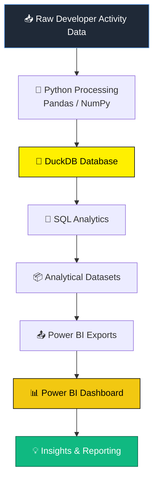

<div align="center">

# 🧠 CogniStream

### From Developer Activity Data to Analytical Insights

*Understanding developer activity, team workflows, and IDE session quality through data analytics*

<br>


<br>

| 📊 **21,128** | 👩‍💻 **20** | 🧩 **4** | ⏱️ **1,226** | ✅ **99.18%** |
| :---: | :---: | :---: | :---: | :---: |
| Events | Developers | Teams | IDE Sessions | Session Quality |

[Overview](#-project-overview) • [Architecture](#%EF%B8%8F-architecture) • [Dataset](#-dataset) • [Dashboard](#-power-bi-dashboard) • [Setup](#%EF%B8%8F-setup--execution) • [Findings](#-key-findings)

</div>

---

## 📌 Project Overview

**CogniStream** turns raw developer event data into structured datasets, SQL-driven insights, and interactive **Power BI dashboards**.

It demonstrates an end-to-end analytics workflow: **ingest → transform → store → query → visualize → report**.

> 💡 **Stack at a glance:** Python for processing, DuckDB for analytical storage, SQL for aggregation, Power BI for reporting.

## 🎯 Objectives

- 🔄 Process raw developer activity datasets with Python
- 🦆 Store and analyze structured data in DuckDB
- 🔎 Run analytical queries with SQL
- 👥 Measure developer and team activity patterns
- 🧪 Analyze IDE sessions and flag session-quality issues
- 📤 Export analytical datasets for Power BI
- 📈 Build dashboards that communicate key metrics clearly
- 🎓 Demonstrate practical data analytics and BI skills

## 🏗️ Architecture



Data processing, analytical storage, SQL analysis, and visualization are kept as separate stages.

## 🛠️ Technology Stack

| | Technology | Purpose |
| :-: | --- | --- |
| 🐍 | **Python** | Data processing and workflow automation |
| 🐼 | **Pandas** | Data manipulation and transformation |
| 🔢 | **NumPy** | Numerical operations |
| 🦆 | **DuckDB** | Analytical database and SQL execution |
| 🧮 | **SQL** | Aggregation, analysis, and analytical views |
| 📉 | **Matplotlib** | Data visualization |
| 🎨 | **Seaborn** | Exploratory data visualization |
| 📓 | **Jupyter Notebook** | Exploratory analysis and experimentation |
| 📊 | **Power BI** | Interactive dashboards and business intelligence |
| 🌿 | **Git / GitHub** | Version control and collaboration |

## 📊 Dataset

CogniStream uses **synthetic** developer activity data simulating a software organization during **September 1–30, 2026**.

| Metric | Value |
| --- | ---: |
| Total developer events | **21,128** |
| Developers | **20** |
| Teams | **4** |
| IDE sessions | **1,226** |
| IDE events associated with sessions | **16,249** |

**Teams:** 🔧 Backend • 🎨 Frontend • 🗃️ Data • ☁️ DevOps — five developers each.

### Event Types

| Event Type | Count | Share |
| --- | ---: | --- |
| 💻 `IDE_ACTIVE` | 16,249 | `██████████████████░░` 76.9% |
| 🔀 `GITHUB_COMMIT` | 1,948 | `██░░░░░░░░░░░░░░░░░░` 9.2% |
| 💬 `SLACK_NOTIFICATION` | 1,407 | `█░░░░░░░░░░░░░░░░░░░` 6.7% |
| 🔁 `TASK_SWITCH` | 775 | `█░░░░░░░░░░░░░░░░░░░` 3.7% |
| 📅 `MEETING` | 749 | `█░░░░░░░░░░░░░░░░░░░` 3.5% |
| **Total** | **21,128** | |

> ⚠️ These figures describe a synthetic dataset. Treat them as analytical inputs, not real-world measurements of employee performance.

## 🗄️ Database & Data Processing

DuckDB is the analytical engine, stored locally as `cognistream.duckdb`.

| Table | Purpose |
| --- | --- |
| `events` | Developer activity event records |
| `ide_events_with_sessions` | IDE activity records associated with sessions |
| `ide_sessions` | Aggregated IDE session records |
| `developer_metrics` | Developer-level analytical metrics |
| `team_metrics` | Team-level analytical metrics |

### Workflow

1. 📖 Read the available source datasets
2. 🐍 Load and process data with Python
3. 🦆 Store data in DuckDB
4. 🧮 Run SQL queries and analytical views
5. 🧪 Perform session-quality checks
6. 📤 Export datasets for Power BI

<details>
<summary><b>📜 Relevant scripts (click to expand)</b></summary>

```text
src/
└── database/
    ├── load_data.py
    ├── run_analysis.py
    ├── export_powerbi.py
    └── export_developer_analytics.py

sql/
├── cognistream_analysis.sql
├── cognistream_views.sql
└── session_quality_checks.sql
```

</details>

## 🔍 Analytical Areas

<table>
<tr>
<td width="50%" valign="top">

### 1️⃣ Developer Activity
Event frequency, activity type distribution, activity over time, and developer-level metrics.

</td>
<td width="50%" valign="top">

### 2️⃣ Team Activity
Compares Backend, Frontend, Data, and DevOps: event counts, frequent event types, and task-switch differences.

*Activity volume alone does not establish productivity.*

</td>
</tr>
<tr>
<td width="50%" valign="top">

### 3️⃣ IDE Session Quality
Flags sessions that need extra attention.

| Category | Sessions |
| --- | ---: |
| ✅ `OK` | 1,216 |
| ⚠️ `ZERO_DURATION_SINGLE_EVENT` | 10 |
| **Total** | **1,226** |

Session quality rate: **~99.18%**

</td>
<td width="50%" valign="top">

### 4️⃣ Developer Analytics
Developer-level metrics from activity and session data.

*Event counts and IDE activity are not measures of code quality or employee performance.*

### 5️⃣ Executive Insights
High-level page that communicates the main patterns without digging into every table.

</td>
</tr>
</table>

## 📈 Power BI Dashboard

📁 `powerbi/CogniStream_Analytics.pbix`

| Page | Name | What it shows |
| :-: | --- | --- |
| **01** | 🏠 Overview | Total events, developers, teams, IDE sessions; activity distribution and team comparisons |
| **02** | 👥 Team Activity | Event distribution and task-switch differences between teams |
| **03** | 🧪 Session Quality | Session counts and validation checks (`OK` vs flagged) |
| **04** | 🧑‍💻 Developer Analytics | Activity differences across the 20 developers |
| **05** | 🎯 Executive Insights | Selected metrics and findings for a high-level audience |

### 🖼️ Screenshots

<!-- Replace the paths below once screenshots are added -->

| Overview | Team Activity |
| :-: | :-: |
|  |  |

| Session Quality | Developer Analytics |
| :-: | :-: |
|  |  |

| Executive Insights |
| :-: |
|  |

## 📂 Project Structure

```text
CogniStream/
│
├── 📁 data/
│   ├── raw/
│   └── powerbi/
│
├── 📁 notebooks/
│
├── 📁 powerbi/
│   └── CogniStream_Analytics.pbix
│
├── 📁 src/
│   └── database/
│       ├── load_data.py
│       ├── run_analysis.py
│       ├── export_powerbi.py
│       └── export_developer_analytics.py
│
├── 📁 sql/
│   ├── cognistream_analysis.sql
│   ├── cognistream_views.sql
│   └── session_quality_checks.sql
│
├── 📄 README.md
└── 📄 .gitignore
```

*Representative structure of the main components. Additional files may exist in the repository.*

## ⚙️ Setup & Execution

**Prerequisites:** Python 3.11+ (also developed on 3.13), Git, and Power BI Desktop.

```bash
# 1️⃣ Clone
git clone https://github.com/PritwishSaha/CogniStream.git
cd CogniStream
```

```powershell
# 2️⃣ Create and activate a virtual environment (Windows PowerShell)
python -m venv .venv
.\.venv\Scripts\Activate.ps1

# 3️⃣ Install dependencies (if requirements.txt is present)
pip install -r requirements.txt

# 4️⃣ Load the data into DuckDB
python src/database/load_data.py

# 5️⃣ Run the analysis
python src/database/run_analysis.py

# 6️⃣ Export Power BI datasets
python src/database/export_powerbi.py
python src/database/export_developer_analytics.py
```

**7️⃣ Open the report:** open `powerbi/CogniStream_Analytics.pbix` in Power BI Desktop, point the data sources at the CSVs in `data/powerbi/`, then refresh.

> 📝 If `requirements.txt` is missing, install dependencies based on the imports in the Python scripts. Step 4 needs the source datasets at the paths configured in the script, and steps 6 onward assume the DuckDB database exists with all required tables.
>
> The commands document the intended execution order; a clean-environment run should be verified before treating setup as fully reproducible.

## 📁 Power BI Export Files

Stored in `data/powerbi/`:

| File | Purpose |
| --- | --- |
| `event_overview.csv` | Event-level reporting data |
| `team_activity.csv` | Team activity summary |
| `session_quality.csv` | Session-quality reporting data |
| `developer_analytics.csv` | Developer-level reporting metrics |

## 💡 Key Findings

- 📊 **21,128** recorded developer events across **four teams**
- 💻 IDE activity is the largest category with **16,249** records
- 👩‍💻 **20** developers and **1,226** IDE sessions
- ✅ **1,216** sessions classified `OK`, **10** as `ZERO_DURATION_SINGLE_EVENT`
- 📈 A **five-page** Power BI report covers overview, team, session, developer, and executive views

> These findings describe the current synthetic dataset and are not evidence of real organizational productivity or employee performance.

## 🚧 Remaining Work

- [ ] Confirm local Git commits are synchronized with GitHub
- [ ] Run the complete pipeline from data loading to Power BI export
- [ ] Verify record counts stay consistent after reloading
- [ ] Confirm all Power BI data sources refresh successfully
- [ ] Add screenshots of all five dashboard pages
- [ ] Verify setup instructions in a clean environment
- [ ] Record a short project demonstration
- [ ] Complete the final documentation review

## 🔮 Future Improvements

*Potential ideas, not features implemented in the current version.*

- 🧹 Automated data quality reports
- 🕒 Additional time-based activity analysis
- 🔬 More detailed developer and team comparisons
- 🔁 Scheduled data refresh workflows
- 📝 Automated report generation
- 🧠 Expanded analytical views and documented business questions

## ⚠️ Limitations

- The project uses **synthetic** developer activity data
- Activity frequency does not directly measure productivity
- Session-quality classifications depend on the implemented validation rules
- The analysis does not establish causation between activity patterns and development outcomes
- Findings are limited to the available data and selected metrics

## 👨‍💻 Author

<div align="center">

**Pritwish Saha**

B.Tech — Computer Science and Engineering (AI & ML)

[](https://github.com/PritwishSaha)
[](https://www.linkedin.com/in/pritwish-saha-b49604362/)

</div>

## 📄 License

Add a license to the repository if you intend to distribute the project under specific reuse permissions.

---

<div align="center">

⭐ **If you found this project useful, consider giving it a star!** ⭐

**CogniStream — From Developer Activity Data to Analytical Insights**

</div>